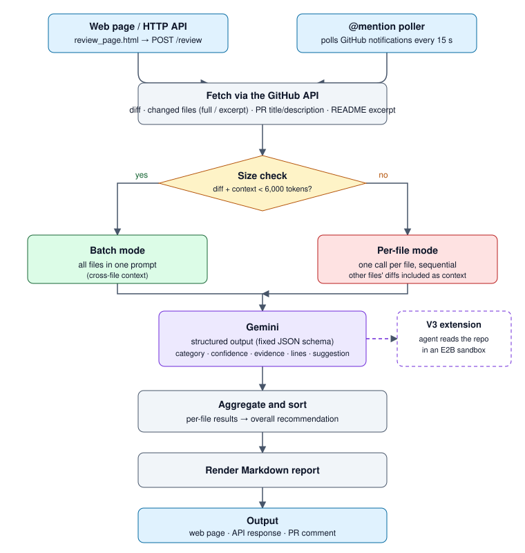
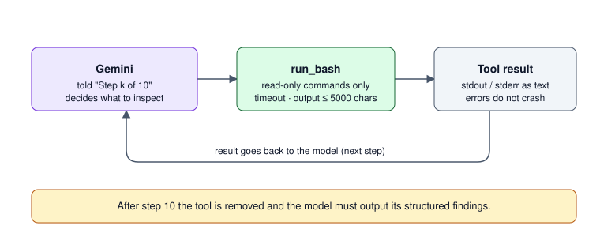

# PR Review Agent

A small tool that uses an LLM (currently the Google Gemini API) to review GitHub PRs automatically.
It reviews remote GitHub PRs through an API (requires E2B_API_KEY and GEMINI_API_KEY; the agent explores the PR code in an E2B sandbox).

## Architecture



*Review workflow as designed in the project report: V2 routes a PR by size (batch vs per-file); the dashed box is the V3 sandbox extension. The version currently on `main` is the V3 flow described below: PRs over the token threshold are rejected, and every review runs the agent in the E2B sandbox.*

Flow of `main` in text form:

```
Input (PR URL)
   → fetch the diff and the project background (PR title/description, the beginning of the README)
   → check the total token count of all diffs: above BATCH_TOKEN_THRESHOLD the PR is not reviewed,
     and a "PR too large" reply is returned (the API answers 413; for an @mention it is posted as a PR comment)
   → otherwise all files are sent to Gemini at once, and the agent can explore the code in an E2B sandbox
   → Gemini returns a structured result in a fixed schema (category, confidence, quoted source code, suggestion, ...)
   → aggregate and sort
   → produce a Markdown report (in English)
```

### How the agent explores the code



## Files

### Core logic
- `reviewer.py` — calls the Gemini API: `check_pr_size()` rejects PRs that are too large and `review_pr_files()` reviews all files at once;
  the system prompt, the few-shot examples and the Pydantic schema also live here
- `aggregator.py` — aggregates the results of all files, sorts them by category and conclusion, and computes the overall conclusion of the PR
- `report.py` — turns the aggregated result into a Markdown report

### Diff parsing
- `diff_reader.py` — parses git diff text into structured data
- `context_builder.py` — builds the LLM input from the diff and truncates the README / PR description
- `sandbox_tools.py` — the E2B sandbox (checks out the PR, disables the network) and the only tool, `run_bash`

### API version (reviews remote GitHub PRs)
- `github_diff_reader.py` — fetches the diff and basic information of a remote PR through the GitHub API
- `github_context_builder.py` — fetches the README through the GitHub API
- `api.py` — wraps everything with FastAPI and provides the `/review` endpoint
- `review_page.html` — a standalone small web page: enter a PR URL and it calls the local API

### Abandoned attempt
- `bookmarklet.js` / `bookmarklet.min.txt` — the original idea was to call the API directly from a browser
  bookmark on the GitHub page, but GitHub's CSP security policy blocks it, so
  `review_page.html` replaces it. Kept for the record.

## Review result

Each issue contains:

| Field | Description |
|---|---|
| `category` | 7 categories: `bug` / `security` / `performance` / `style` / `refactor` / `nitpick` / `question` |
| `confidence` | `high` / `medium` / `low`, how sure the model is about this issue |
| `evidence` | verbatim quote of the source code that triggers the issue (reduces the chance of the model inventing problems) |
| `start_line` / `end_line` | the line range of the issue |
| `comment` / `suggestion` / `suggested_code` | description of the issue, suggested change, and code that can be applied directly (may be empty) |

Each file also has a `change_intent` (what the change in this file tries to do) and a `recommendation`
(`looks_good` / `minor_comments` / `needs_changes`); the conclusion of the whole PR is the most severe one among all files.

The report first lists the PR title (API version only), the overall conclusion and a file overview table; only files with issues are expanded in detail,
and files without issues are collected at the end, one line per file. The report, the terminal output and the web interface are all in English.

## Environment setup

```bash
python3 -m venv venv
source venv/bin/activate
pip install -r requirements.txt
export GEMINI_API_KEY=your_Gemini_key
export E2B_API_KEY=your_E2B_key      # required: without a sandbox no review is done
export GITHUB_TOKEN=your_GitHub_token  # optional: needed for the sandbox checkout of private repos and for @mention polling
```

Instead of `export`, you can copy `.env.example` to `.env` and fill in the values (`.env` is git-ignored).

## Usage

### API version (reviews remote GitHub PRs)

1. Start the API service:
   ```bash
   uvicorn api:app --reload --port 8000
   ```
2. Open `review_page.html` in Chrome (not Safari, whose file:// permissions are stricter)
3. Paste a PR URL and click "Start review"

### @mention polling

If `GITHUB_TOKEN` is set, starting the API also starts a background poller. Every 15 seconds (change it with
`POLL_INTERVAL_SECONDS`) it reads your unread GitHub notifications; when someone @mentions you on a pull request, it
reviews that PR and posts the report as a comment on it. The token needs the `notifications` and `repo` scopes.
Without `GITHUB_TOKEN` the poller is disabled and only the web page / `POST /review` can be used.

Reading the PR information, the diff and the README uses anonymous GitHub API calls (about 60 requests per hour),
and one review takes about 3 requests, so only **public repos** are supported for now.

Review flow: first check the diff size (if it is too large, return 413 / post a "PR too large" comment), then create the E2B sandbox,
shallow-checkout the PR and disable the network right away; the agent has only one `run_bash` tool,
at most 10 rounds of "LLM → tool → result", after which the tool is taken away and the agent is forced to output its result; a single tool output is capped at 5000 characters.

## Known limitations / ideas for improvement

- The diff and README are fetched with anonymous GitHub API calls, so the rate limit is low and private repos cannot be reviewed (`GITHUB_TOKEN` is only used for the sandbox checkout and the @mention poller)
- Reviews are triggered by the web page or by an @mention picked up by polling; there is no webhook trigger
- The review is posted as one report comment (or shown on the web page), not as inline comments on the PR's lines
- It can currently only run locally and has not been deployed to the cloud
- PRs above the token threshold are not reviewed; the user is only asked to split them
- Only the first 6000 characters of the README and the first 3000 characters of the PR description are used; there is no full project architecture summary yet
- Review quality was evaluated on a sample of AACR-Bench pull requests (data and scripts are on the `alaric/aacr-eval` branch, not on `main`); the effect of
  the few-shot examples and the project background has not been measured separately
- There are no dedicated few-shot examples for the `refactor` and `question` categories yet
